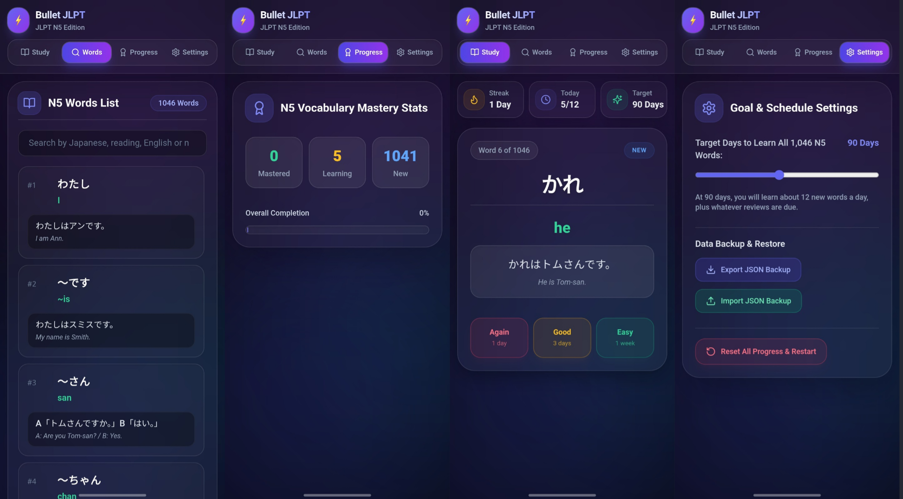

# 🚄 Bullet JLPT — JLPT N5 Edition

**Bullet JLPT** is an offline-first Japanese vocabulary memorization app built for learners preparing for the **JLPT N5** exam. Powered by a custom Spaced Repetition System (SRS) and wrapped with Capacitor for native Android performance, it helps you pace through **1,046 N5 words** on your own schedule—no internet connection required.
---
# User Interface

---

## ✨ Features
- **Complete JLPT N5 Dataset (1,046 Words):** Includes Kanji, Kana readings, English meanings, and contextual example sentences with Furigana support.
- **Smart Spaced Repetition (SRS):** Adaptive review intervals (`Again`, `Good`, `Easy`) that prioritize due reviews alongside daily new word quotas.
- **Customizable Target Pace:** Set your goal between **15 and 180 days**—automatically calculates daily new word targets to finish on schedule.
- **Instant Dictionary (`Words` Tab):** Search across all 1,046 entries by Kanji, Kana, English meaning, or word ID.
- **Progress & Streak Tracking:** Visual mastery breakdown (`New`, `Learning`, `Mastered`), completion bar, and daily study streak counter.
- **100% Offline & Native Backup:** Stores progress locally and supports native Android JSON export/share and import for hassle-free device transfers.

## 🛠️ Tech Stack
- **Frontend:** React, TypeScript, Vite, Tailwind CSS, Lucide Icons
- **Mobile Runtime:** Capacitor (`@capacitor/android`, `@capacitor/filesystem`, `@capacitor/share`)
